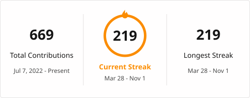

<h1 align="center">Hi 👋, I'm Ish Bandhu Shukla</h1>

  

  
  
  

  
  
  

---

### 🚀 About Me

I'm a Full Stack Developer with **3+ years of experience** building SaaS, fintech and AI products with **React.js, Next.js, TypeScript and Node.js**.

- 🏢 At **VFPL Capital** I built an enterprise SaaS (**CorpVue**) and a fintech platform (**Finconic**) from scratch: REST API design, JWT/RBAC auth and MongoDB data modelling
- 🤖 Since then I've independently shipped **three live apps**, including **Forgey**, an agentic AI app builder
- ⚡ I care about performance, clean APIs and shipping end to end, from schema to deployment
- 📍 Based in **Berlin**, eligible to work in Germany **immediately**, no sponsorship required

| | |
|---|---|
| 💼 **Looking for** | Frontend / Full Stack Developer roles (Berlin, hybrid or remote) |
| 🛂 **Work permit** | Eligible to work in Germany, no sponsorship needed |
| 🗣️ **Languages** | English (C2) · Hindi (Native) · German (A2) |
| 🎓 **Education** | M.A. International Management, IU Berlin · B.Tech ECE, JSS Noida |

---

### 💼 Experience

**Independent Developer** · Self-Employed · Berlin · *Nov 2024 – Present*
- Shipped three production apps end to end (see my pinned repos below) on Next.js, TypeScript, Node.js, PostgreSQL and MongoDB, deployed on Vercel with GitHub CI/CD

**Full Stack Developer** · VFPL Capital Pvt. Ltd. · Delhi · *Sept 2023 – Oct 2024*
- Built **CorpVue** (enterprise SaaS) and **Finconic** (fintech) from scratch: 5+ modules with multi-role dashboards, document management, and loan and investment workflows
- Engineered **15+ REST endpoints** with JWT, RBAC and MongoDB aggregation pipelines, deployed on **AWS (EC2, S3)**
- Improved load performance across 5+ modules with code-splitting, lazy loading and a **migration to Vite**

<b>Earlier roles (2022 – 2023)</b>

 

- **Freelance Full Stack Developer** · Remote · *Jul – Aug 2023*: delivered 3 client apps end to end
- **Full Stack Developer** · FinvestFX (contract) · *Apr – Jun 2023*: built 10+ React components and 8 REST endpoints, and automated releases with GitHub Actions
- **Associate Full Stack Engineer** · Political Data Inc. (contract) · *Feb – Apr 2023*: maintained 6 modules and fixed 30+ production bugs
- **Full Stack Development Intern** · Masai School · *Mar – Dec 2022*: 900+ hours of training, built 12+ apps

---

### 🛠️ Tech Stack

| Area | Technologies |
|---|---|
| **Frontend** |  |
| **UI** |  &nbsp; shadcn/ui · Chakra UI · Framer Motion |
| **Backend** |  &nbsp; REST · Socket.io · WebSockets · JWT · RBAC |
| **Databases** |  &nbsp; Mongoose · Neon DB · Aggregations |
| **AI** | Vercel AI SDK · LLM Integration · Agentic Workflows · Prompt Engineering |
| **Cloud & DevOps** |  &nbsp; EC2 · S3 · CI/CD |
| **Tools** |  &nbsp; JIRA · Agile/Scrum · Code Review |

---

### 📊 GitHub Stats

  
  

  

---

<h3 align="center">🤝 Hiring for a Frontend or Full Stack role? Let's talk.</h3>

  
  
  

  

